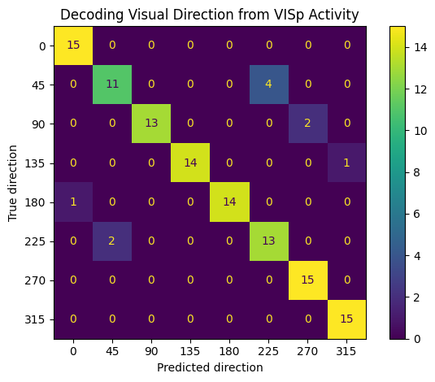
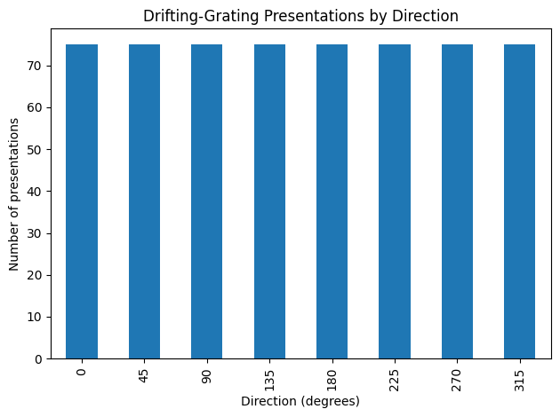
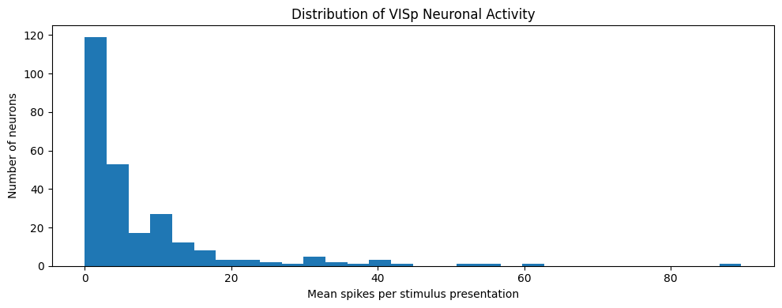

# Mouse V1 Visual Direction Decoder

Can a linear decoder identify a visual stimulus from the activity of a neural population?

This self-directed computational-neuroscience project uses Allen Institute Visual Coding Neuropixels data to decode eight drifting-grating direction labels from spike counts recorded in mouse primary visual cortex (VISp). The model is a standardized multiclass logistic-regression pipeline.

## Baseline result

| Quantity | Value |
|---|---:|
| Allen session | `757216464` |
| Valid stimulus presentations | 600 |
| VISp units | 261 |
| Direction classes | 8 |
| Chance accuracy | 12.5% |
| Holdout accuracy | **91.7%** |

The 91.7% result comes from **one stratified 80/20 split** (`random_state=42`). It is a baseline, not a cross-validated estimate of generalization. No hyperparameter search was performed on the test set.



The most prominent errors in this split occurred between labels separated by 180° (especially 45° and 225°). That observation motivates a planned comparison of eight direction classes with four orientation-axis classes.

## Cross-Validated Results

Five-fold stratified cross-validation was used to generate out-of-fold predictions for every trial.

| Task | Accuracy | Balanced accuracy | Macro-F1 | Chance |
|---|---:|---:|---:|---:|
| Eight-direction decoding | **89.83%** | 89.83% | 89.82% | 12.5% |
| Four-orientation decoding | **99.67%** | 99.67% | 99.67% | 25.0% |

The direction decoder performed far above a shuffled-label baseline. Across 200 label permutations, mean null accuracy was 12.47% (SD 1.49%). None of the permuted scores reached the observed accuracy, giving an empirical p-value of 0.00498.


## Population-Size Scaling

Direction-decoding accuracy increased consistently as more VISp units were included. Each population size was evaluated using 20 independently sampled neuron subsets with five-fold cross-validation.

| VISp units | Mean accuracy | Standard deviation |
|---:|---:|---:|
| 5 | 28.4% | 9.5% |
| 10 | 40.8% | 10.2% |
| 25 | 61.0% | 5.1% |
| 50 | 71.2% | 4.5% |
| 100 | 79.4% | 3.8% |
| 200 | 86.4% | 1.4% |
| 261 | 88.6% | 1.0% |

The monotonic increase indicates that direction information is distributed across the VISp population rather than being carried by only a few sampled units.


## Analysis pipeline

1. Read drifting-grating presentation times and labels from the NWB file with `h5py`.
2. Remove presentations with undefined labels.
3. Map unit peak channels to Allen structure acronyms and retain `VISp` units.
4. Count each unit's spikes during each stimulus presentation.
5. Construct a `600 × 261` trial-by-neuron feature matrix.
6. Fit `StandardScaler` and multiclass `LogisticRegression` on the training set only.
7. Evaluate holdout accuracy and the confusion matrix.

The NWB field used as the target is named `orientation`; throughout this project, its eight values (0° through 315°) are treated as drifting-grating direction labels.

## Data checks

All eight labels contain 75 usable presentations:



The distribution below summarizes mean spike counts per presentation across the 261 selected VISp units:



## Repository layout

```text
mouse-v1-direction-decoder/
├── notebooks/
│   └── analysis.ipynb
├── scripts/
│   └── run_extended_analysis.py
├── src/mouse_v1_decoder/
│   └── evaluation.py
├── tests/
│   └── test_evaluation.py
├── results/
│   ├── confusion_matrix.png
│   ├── direction_counts.png
│   └── mean_spikes_per_neuron.png
├── .gitignore
├── README.md
├── pyproject.toml
└── requirements.txt
```

## Reproduce the notebook

This project was developed with Python 3.11. Create an environment and install the pinned dependencies:

```bash
python -m venv .venv

# macOS/Linux
source .venv/bin/activate

# Windows PowerShell
# .venv\Scripts\Activate.ps1

python -m pip install --upgrade pip
pip install -r requirements.txt
jupyter notebook notebooks/analysis.ipynb
```

The Allen NWB file is about 3 GB and is intentionally excluded from GitHub. Arrange the local files as follows:

```text
data/
├── channels.csv
└── session_757216464/
    └── session_757216464.nwb
```

After the notebook constructs `X` and `y`, run its final export cell. Then launch the extended analysis:

```bash
python scripts/run_extended_analysis.py
```

That command produces:

- Five-fold out-of-fold metrics and confusion matrices for direction and orientation-axis labels
- A label-permutation baseline with a finite-sample p-value
- Repeated neuron-subsampling estimates across population sizes
- Machine-readable JSON and CSV results under `results/extended/`

Run the synthetic unit tests with:

```bash
python -m unittest discover -s tests
```

## Limitations and next experiments

- Run and report the included cross-validation, permutation, population-size, and orientation analyses on the local NWB-derived feature matrix.
- Test whether conclusions generalize across recording sessions.
- Investigate whether trial ordering or slow session drift inflates random-fold performance by comparing blocked or time-aware splits.

## Acknowledgment

Data come from the Allen Institute Brain Observatory Visual Coding Neuropixels dataset. The raw data are not redistributed in this repository.
