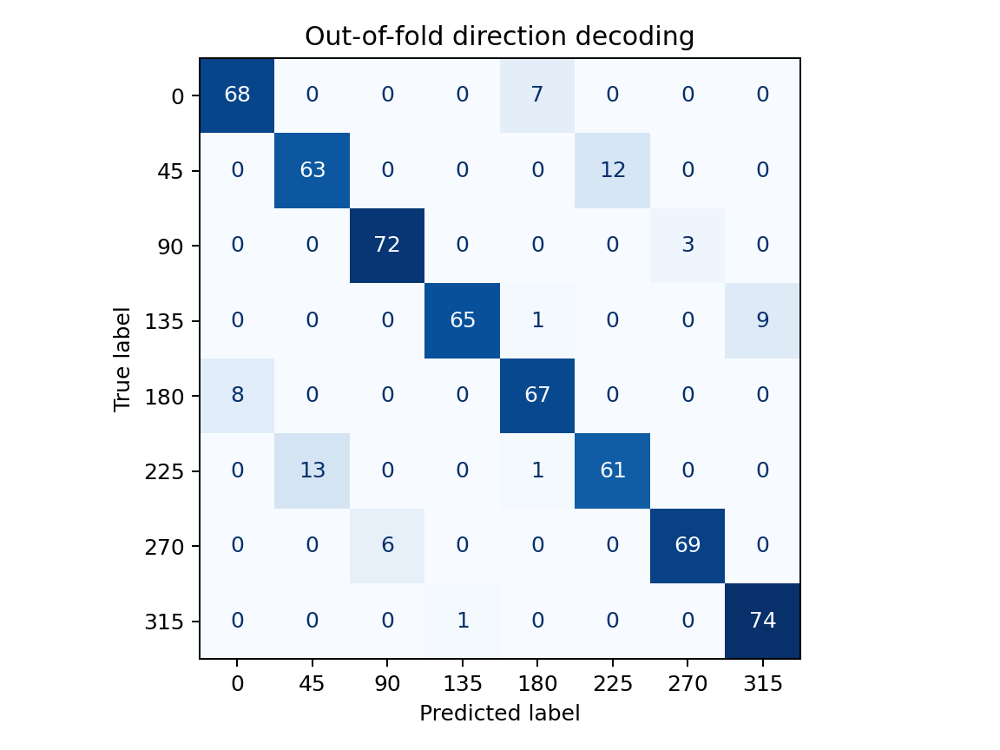
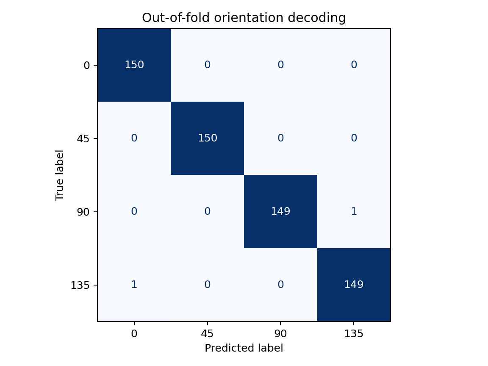
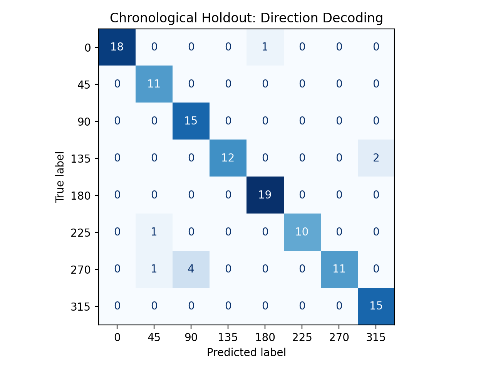
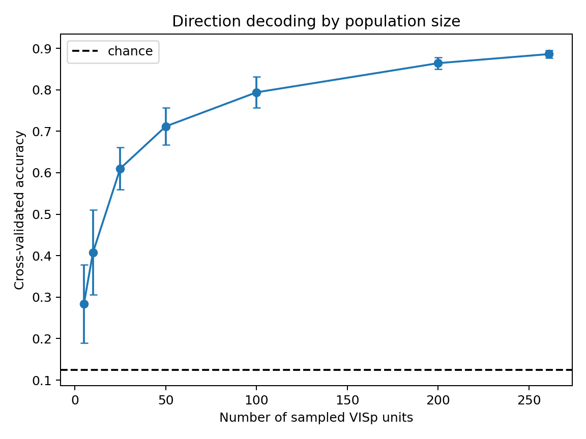

# Mouse V1 Visual Direction Decoder

**Neural population coding, stimulus decoding, and generalization in mouse primary visual cortex**

Can a linear decoder identify the direction of a visual stimulus from the activity of a neural population? How does decoding accuracy change with the number of neurons observed, and does performance generalize to later recording periods?

This self-directed computational neuroscience project uses Allen Institute Visual Coding Neuropixels recordings to investigate these questions using spike-count features from mouse primary visual cortex (VISp).

The project evaluates a standardized multiclass logistic regression decoder using randomized cross-validation, neuron-population subsampling, permutation testing, and chronological holdout validation.

## 1. Dataset

| Property | Value |
|---|---|
| Source | Allen Institute Brain Observatory Visual Coding Neuropixels |
| Session ID | `757216464` |
| Brain region | Primary visual cortex (`VISp`) |
| Valid stimulus presentations | 600 |
| Recorded VISp units used | 261 |
| Stimulus direction classes | 8 |
| Directions | 0°, 45°, 90°, 135°, 180°, 225°, 270°, 315° |
| Chance-level accuracy | 12.5% |

The dataset contains extracellular electrophysiological recordings obtained during visual stimulus presentations.

The NWB field used as the classification target is named `orientation`. Its eight values are treated here as drifting-grating direction labels. This interpretation should be verified against the official stimulus metadata.

Raw NWB recordings are not redistributed in this repository.

## 2. Research Objectives

This project investigates three questions:

1. How accurately can visual stimulus direction be decoded from mouse V1 population spike counts?
2. How does decoding performance change as the number of observed neurons increases?
3. How well does a decoder trained on earlier stimulus presentations generalize to later presentations?

A secondary analysis compares decoding of eight motion-direction labels with four orientation-axis labels.

## 3. Methodology

### Neural feature extraction

Stimulus presentation times and labels are extracted from the NWB recording using `h5py`.

Units are assigned to brain regions by matching their peak-channel identifiers with the Allen channel metadata.

Only units assigned to `VISp` are retained.

For each stimulus presentation, spikes are counted within the presentation interval for every selected neuron.

This produces a feature matrix:

- `X`: 600 trials × 261 neurons
- `y`: 600 stimulus-direction labels

Each feature represents the number of spikes recorded from one neuron during one stimulus presentation.

### Classification model

The decoder uses a scikit-learn pipeline consisting of:

- `StandardScaler`
- `LogisticRegression(max_iter=3000, random_state=42)`

Standardization is performed within each training fold or training partition, preventing information from the held-out observations from influencing the fitted scaling parameters.

No neural network architecture or deep learning model is required.

### Randomized cross-validation

Five-fold stratified cross-validation is used to generate out-of-fold predictions for all 600 trials.

The implementation uses `StratifiedKFold` with shuffled trials and a fixed random seed.

Performance is evaluated using accuracy, balanced accuracy, macro-F1, and confusion matrices.

### Chronological holdout

A separate evaluation trains the model on the first 480 stimulus presentations and tests it on the final 120 presentations.

The script verifies that the presentation timestamps are chronologically ordered and that the stimulus labels match the reconstructed feature matrix.

This experiment evaluates performance on a later portion of the same recording session.

It does not establish generalization across different animals or recording sessions.

## 4. Results

### Direction and orientation decoding

| Evaluation | Accuracy | Balanced accuracy | Macro-F1 |
|---|---:|---:|---:|
| Eight-direction, randomized five-fold CV | **89.83%** | 89.83% | 89.82% |
| Four-orientation, randomized five-fold CV | **99.67%** | 99.67% | 99.67% |
| Eight-direction, original random 80/20 holdout | **91.67%** | — | — |
| Eight-direction, chronological 80/20 holdout | **92.50%** | 92.51% | — |

The original randomized holdout used a stratified 80/20 split with `random_state=42`.

The chronological evaluation correctly classified 111 of 120 held-out presentations.

The randomized cross-validation and chronological holdout use different training and testing partitions. Their accuracy estimates should not be interpreted as directly comparable measurements of improvement.







### Population-size scaling

To investigate how the number of recorded neurons influences decoding performance, subsets of VISp units were sampled without replacement.

Each population size was evaluated over 20 repeated neuron-subset selections using five-fold stratified cross-validation.

| VISp units | Mean accuracy | Standard deviation |
|---:|---:|---:|
| 5 | 28.4% | 9.5% |
| 10 | 40.8% | 10.2% |
| 25 | 61.0% | 5.1% |
| 50 | 71.2% | 4.5% |
| 100 | 79.4% | 3.8% |
| 200 | 86.4% | 1.4% |
| 261 | 88.6% | 1.0% |

Accuracy increased with the number of sampled neurons, with diminishing gains at larger population sizes.

These results are consistent with the presence of decodable stimulus information across neural populations. They do not independently establish how information is distributed or whether particular neurons are causally necessary.

Repeated neuron subsets are not independent biological recordings.



### Permutation testing

A label-permutation analysis was performed using 200 shuffled-label evaluations.

| Statistic | Result |
|---|---:|
| Observed accuracy | 89.83% |
| Mean null accuracy | 12.47% |
| Null standard deviation | 1.49 percentage points |
| Empirical p-value | 0.00498 |

None of the 200 shuffled-label accuracies equaled or exceeded the observed accuracy.

The empirical p-value was calculated using a finite-sample correction.

The test provides evidence against a trial-exchangeable shuffled-label null hypothesis. It does not independently rule out temporal or experimental confounding.

### Chronological generalization

The chronological holdout experiment produced:

| Metric | Result |
|---|---:|
| Training trials | 480 |
| Testing trials | 120 |
| Correct predictions | 111 |
| Accuracy | 92.50% |
| Balanced accuracy | 92.51% |

Strong performance on later trials provides an additional within-session robustness check.

The experiment does not eliminate all possible temporal confounding and does not test generalization across recording sessions.

The results are saved in `results/temporal/`.

## 5. Repository Structure
```text
mouse-v1-direction-decoder/
├── notebooks/
│   ├── analysis.ipynb
│   └── explorations.ipynb
├── scripts/
│   ├── prepare_data.py
│   ├── run_extended_analysis.py
│   └── run_temporal_validation.py
├── src/
│   └── mouse_v1_decoder/
│       ├── __init__.py
│       └── evaluation.py
├── tests/
│   └── test_evaluation.py
├── results/
│   ├── extended/
│   ├── temporal/
│   ├── confusion_matrix.png
│   ├── direction_counts.png
│   └── mean_spikes_per_neuron.png
├── .gitignore
├── README.md
├── pyproject.toml
└── requirements.txt
```

Raw neural recordings and locally generated feature matrices are excluded from version control.

## 6. Reproducing the Analysis

### Requirements

Python 3.11 is recommended.

Create and activate a virtual environment:

```bash
python -m venv .venv
```

On Windows PowerShell:

```powershell
.\.venv\Scripts\Activate.ps1
```

On macOS or Linux:

```bash
source .venv/bin/activate
```

Install the dependencies:

```bash
python -m pip install -r requirements.txt
```

### Prepare the dataset

Obtain Allen Visual Coding Neuropixels session `757216464` and its corresponding channel metadata.

Arrange the files locally as:

```text
data/
├── channels.csv
└── session_757216464/
    └── session_757216464.nwb
```

Generate the trial-by-neuron spike-count matrix:

```bash
python scripts/prepare_data.py --data-dir data
```

The script generates:

```text
data/processed/spike_counts.npz
```

The processed file contains arrays `X` and `y`.

### Run cross-validated experiments

```bash
python scripts/run_extended_analysis.py --permutations 200 --repeats 20
```

This produces:

- Direction-decoding metrics
- Orientation-decoding metrics
- Permutation-test statistics
- Population-size results
- Confusion matrices

Results are saved under `results/extended/`.

### Run chronological validation

```bash
python scripts/run_temporal_validation.py --data-dir data
```

This trains the decoder on the first 80% of trials and evaluates it on the final 20%.

Results are saved under `results/temporal/`, including:

- `metrics.json`
- `classification_report.txt`
- `confusion_matrix.png`

### Run automated tests

```bash
python -m unittest discover -s tests
```

## 7. Limitations

This study has several important limitations:

1. **Single recording session:** The analysis uses one Allen Neuropixels session. Results may not generalize to other animals or recording sessions.
2. **Observational decoding:** Classification performance demonstrates that information is decodable from recorded neural activity, not that particular neurons are causally necessary for visual perception.
3. **Randomized cross-validation:** Randomly distributed trials may share recording conditions or temporal dependencies.
4. **Chronological validation:** A single early-to-late split provides a robustness check but does not eliminate all possible temporal confounding.
5. **Population subsampling:** Repeated neuron subsets from one recording do not constitute independent biological replicates.
6. **Linear classification:** Logistic regression measures linearly decodable information and does not characterize all possible neural representations.
7. **Permutation assumptions:** Random label permutation assumes trial exchangeability under the tested null hypothesis.

## 8. Interpretation

The results demonstrate that a linear classifier can decode drifting-grating stimulus labels from population spike counts recorded in mouse V1 under the evaluated conditions.

Decoding accuracy increases as more recorded neurons are included, and high performance is retained in a chronological holdout experiment.

These findings are consistent with established principles of neural population coding. This project is intended as a reproducible computational investigation rather than a claim of discovering a new neural coding mechanism.

## 9. Acknowledgments

Neural recording data were obtained from the Allen Institute Brain Observatory Visual Coding Neuropixels dataset.

The original recordings and metadata are credited to the Allen Institute.

Raw neural data are not redistributed in this repository.
